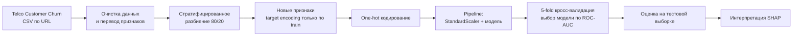

# Прогнозирование оттока клиентов телекоммуникационной компании

[](https://www.python.org/)
[](LICENSE)
[](https://streamlit.io/)
[](https://xgboost.readthedocs.io/)
[](https://shap.readthedocs.io/)

Полноценный ML-проект, решающий бизнес-задачу прогнозирования оттока клиентов телекоммуникационной компании. Репозиторий содержит полный пайплайн: от разведочного анализа (EDA) и продвинутого создания признаков до обучения моделей с кросс-валидацией и интерпретации результатов с помощью SHAP. Финальным этапом является деплой интерактивного веб-приложения на Streamlit.

## Описание предметной области

В телекоммуникационной индустрии удержание существующих клиентов обходится компании в 5–25 раз дешевле, чем привлечение новых. Прогнозирование оттока позволяет выявить абонентов с высокой вероятностью расторжения контракта и предложить им персонализированные условия удержания.

Данный проект реализует не только предиктивную модель, но и слой интерпретируемости. Использование алгоритма SHAP позволяет перейти от модели «черного ящика» к прозрачному анализу: определить, какие именно факторы вносят наибольший вклад в прогноз для каждого конкретного клиента, обеспечивая бизнес обоснованными данными для принятия решений.

## Данные

Используется открытый датасет **Telco Customer Churn** (IBM): 7043 клиента, 19 признаков (демография, подключённые услуги, тип контракта, способ оплаты, ежемесячные и общие платежи) и целевая переменная «Отток». Доля ушедших клиентов около 26,5 %, то есть классы несбалансированы. Данные загружаются по URL при каждом запуске, поэтому для первого запуска нужен доступ в интернет.

## Архитектура пайплайна



## Результаты

| Модель                  | CV ROC-AUC (5 фолдов) | Test ROC-AUC | Test Accuracy |
|-------------------------|-----------------------|--------------|---------------|
| Логистическая регрессия | 0.851 ± 0.012         | 0.847        | 0.737         |
| Случайный лес           | 0.825 ± 0.012         | 0.821        | 0.765         |
| XGBoost                 | 0.834 ± 0.011         | 0.830        | 0.747         |

Метрики по классу «Ушел» на тестовой выборке (порог 0.5):

| Модель                  | Precision | Recall | F1   |
|-------------------------|-----------|--------|------|
| Логистическая регрессия | 0.50      | 0.79   | 0.62 |
| Случайный лес           | 0.55      | 0.64   | 0.59 |
| XGBoost                 | 0.52      | 0.73   | 0.60 |

**Выводы:**

- Лучшей по кросс-валидации и по тесту оказалась логистическая регрессия. Значения CV и Test ROC-AUC близки (0.851 и 0.847), что говорит об отсутствии переобучения и утечек. Простая интерпретируемая модель не уступает ансамблям, что типично для этого датасета.
- Выбор баланса между precision и recall определяется бизнесом. В задачах удержания пропуск уходящего клиента обычно дороже, чем предложение скидки клиенту, который остался бы и так, поэтому приоритет отдан полноте: логистическая регрессия находит 79 % уходящих клиентов ценой того, что только половина клиентов в списке риска действительно уходит. При известной стоимости ошибок порог классификации можно настроить по кривой Precision-Recall.

## Быстрый старт

1. Клонируйте репозиторий:

```bash
git clone https://github.com/armatveeeva/customer-churn-prediction.git
cd customer-churn-prediction
```

2. Установите зависимости (нужны Python 3.11+ и [Poetry](https://python-poetry.org/)):

```bash
poetry install
```

3. Запустите пайплайн обучения. Он выведет метрики моделей и покажет графики (ROC-кривые, матрицу ошибок, Precision-Recall кривую, таблицу метрик):

```bash
poetry run python main.py
```

Либо активируйте виртуальное окружение и запускайте, как обычно:

```bash
source .venv/bin/activate
python main.py
```

4. Запустите веб-приложение на Streamlit:

```bash
poetry run streamlit run app.py

```

## Разработка

В проекте настроены pre-commit хуки: `ruff` (линтинг), `ruff-format` (форматирование) и `mypy` (проверка типов). Установить их можно командой:

```bash
poetry run pre-commit install
```

Если хук изменил файлы, коммит нужно повторить: выполните `git add` для изменённых файлов и `git commit` ещё раз.

<<<<<<< HEAD
Тесты запускаются командой:

```bash
poetry run pytest
```